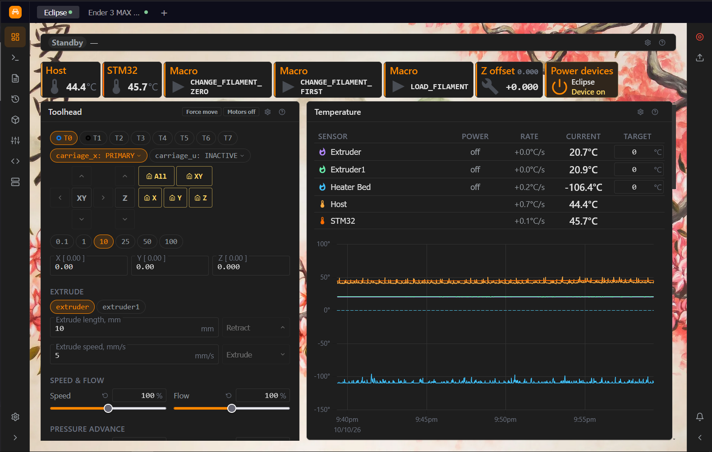
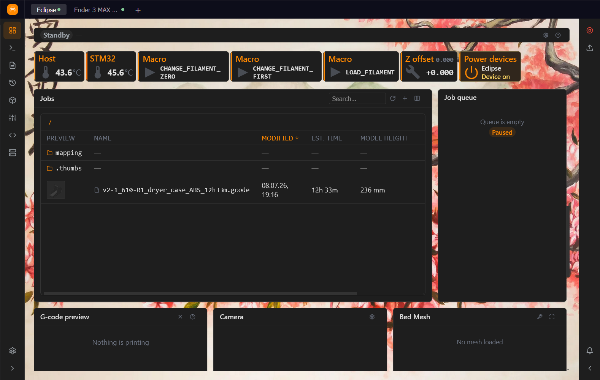
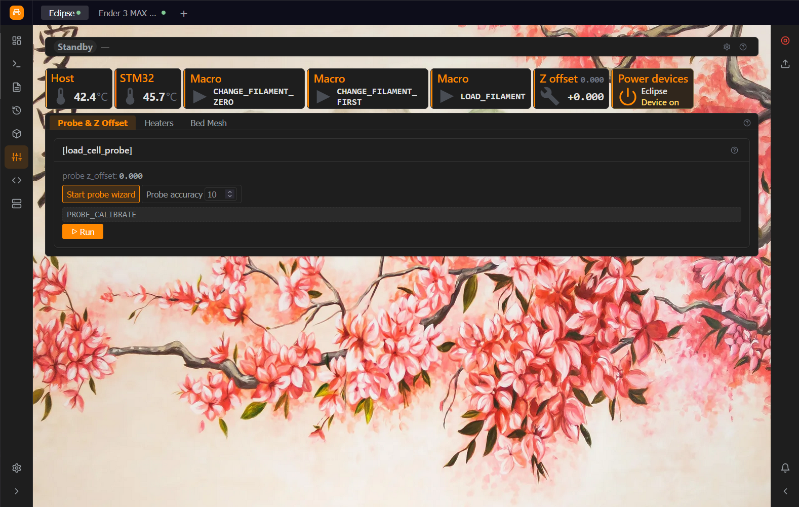
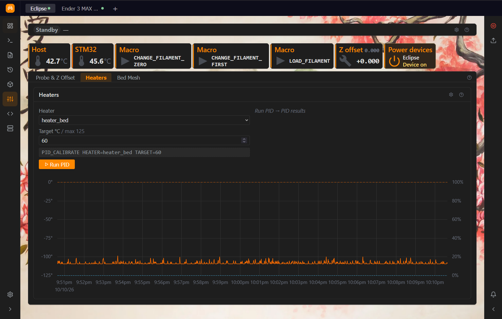
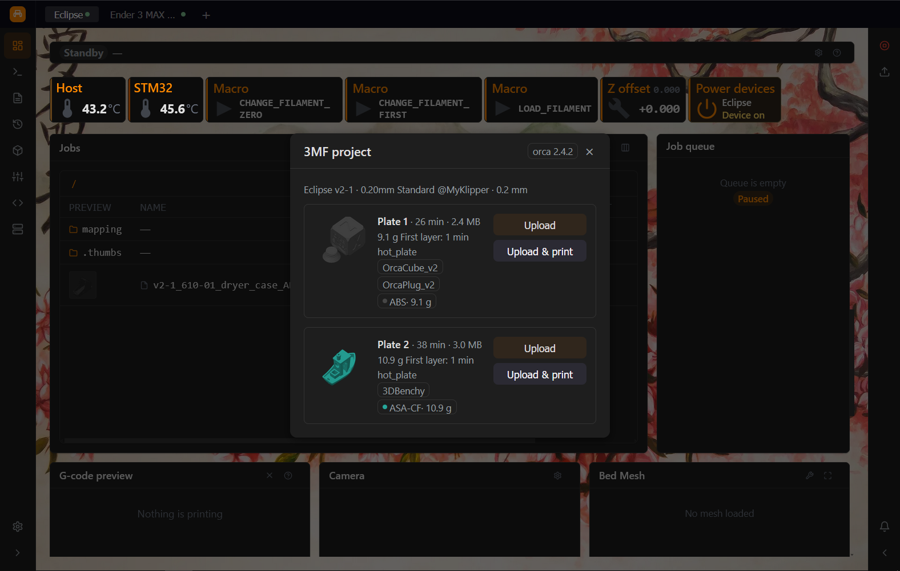
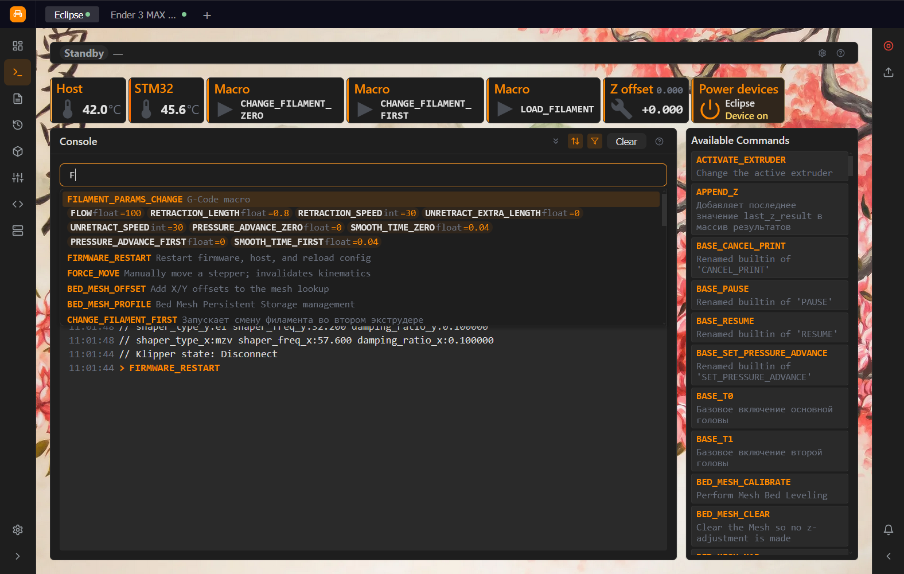

<p align="center">
  <a href="./README.md">English</a> · <strong>Русский</strong>
</p>

<p align="center">
  
</p>

<h1 align="center" id="top">Tessera</h1>

<p align="center">
  <strong>Модульный веб-UI для 3D-принтеров Klipper / Moonraker.</strong><br/>
  Плагинный дашборд: хост оркестрирует, плагины вносят плитки,<br/>
  и всё, что вы видите, — мозаика независимых поверхностей, считываемых одним взглядом.
</p>

<p align="center">
  <a href="LICENSE"></a>
  
  
  
  
  
</p>

---

> *Прочтите это первым: я не программист и не фронтенд-разработчик. Tessera целиком собрана с помощью ИИ. Ожидайте шероховатостей, нестандартных решений и изредка багов, с которыми я ещё не сталкивался. Issues и pull requests искренне приветствуются; если что-то выглядит странно, обычно рядом на пару файлов есть задокументированная причина.*

---

## Содержание

- [Tessera](#top)
- [Возможности](#features)
  - [Дашборд и виджеты](#dashboard-widgets)
  - [Полоса быстрого доступа (чипы)](#quick-access-chip-strip)
  - [Калибровочный набор](#calibration-suite)
  - [Файлы, редактор, превью](#files-editor-preview)
  - [Система и уведомления](#system-notifications)
  - [Консоль](#console)
  - [Мультипринтерность и персонализация](#multi-printer-personalization)
  - [Горячие клавиши](#hotkeys)
- [Требования](#requirements)
- [Установка](#installation)
  - [Одной строкой (Armbian / Debian)](#installer-one-liner)
  - [Вручную / для разработки](#manual-development)
  - [Первый запуск](#first-launch)
- [Разработчикам](#for-developers)
  - [Документация](#documentation)
  - [Архитектура в одном абзаце](#architecture)
  - [Модель плагинов](#plugin-model)
  - [Гарды](#guards)
  - [API горячих клавиш](#hotkeys-api)
  - [Remote-плагины и доставка](#remote-plugins-delivery)
  - [Где живут настройки](#where-settings-live)
  - [Структура проекта](#project-structure)
- [Лицензия](#licensing)
- [Благодарности](#acknowledgments)

---

Tessera — это браузерная панель управления для принтеров Klipper. Она общается с Moonraker напрямую через один WebSocket на принтер, хранит все ваши предпочтения в `localStorage` и **не имеет собственного бэкенда** — на хосте принтера работают Klipper и Moonraker, а Tessera просто красиво их отрисовывает.

UI собран из **плагинов**: хост предоставляет оболочку (вкладки принтеров, сайдбар, дашборд-грид, настройки, тему, поверхности уведомлений), а каждый функциональный блок — графики температур, макросы, мастера калибровки, таблицы файлов — это вклад плагина. Сторонние плагины — полноправные граждане: они загружаются как Custom Elements и могут быть написаны **на любом фреймворке**.

<a id="features"></a>
## Возможности

<a id="dashboard-widgets"></a>
### Дашборд и виджеты

Drag-and-drop грид автономных виджетов, раскладываемый per-принтер:

- **Temperature** — живой мульти-нагревательный график (текущая / цель / мощность), чипы по сенсорам, клик по сенсору = изоляция серии; таблица или компактные **карточки** (автоматически по ширине виджета) и необязательный **таймер времени включения** нагревателя
- **Status** — прогресс печати, слой и ETA, пауза / продолжить / отмена, множители скорости и потока
- **Macros** — кнопки с автоматически собранными формами параметров из тел макросов (дефолты предзаполнены, обязательные поля помечены)
- **Tools** — jog крестом или строками, экструзия и ретракция, force move, отключение моторов, режимы кареток IDEX (PRIMARY / COPY / MIRROR / экспериментальный DIRECT-mode из [форка Klipper Дмитрия Бутюгина для IDEX-принтеров](https://github.com/dmbutyugin/klipper/tree/generic-cartesian)), подсветка активного инструмента, плюс однонажатиевые кнопки **QGL** / **Z-tilt**, когда эти команды доступны
- **Limits** — скорость, ускорение и square-corner velocity на лету
- **Outputs** — слайдеры вентиляторов и управление output-пинами (PWM и цифровые), плюс read-only индикаторы авто-вентиляторов Klipper (heater_fan / controller_fan / temperature_fan)
- **Camera** — живые MJPEG/HLS просмотры, несколько потоков
- **Filament** — статус датчика окончания филамента и включение/выключение
- **Job queue** — переупорядочивание, запуск, управление очередью печати

Каждый виджет автономен по данным: он сам подписывается на прокси, поэтому два виджета никогда не делят скрытый канал, а сломанный плагин не укладывает остальной UI.

<a id="quick-access-chip-strip"></a>
### Полоса быстрого доступа (чипы)

Постоянная полоса под баннерами держит самые срочные контроли в один тап на **любой странице** — посреди печати, на экране заданий, в настройках:

- **Чипы температуры** — текущее значение, бейдж цели, тренд нагрева/остывания, тап открывает поповер с пресета (и необязательным таймером времени включения нагревателя)ми
- **Чипы макросов** — запуск мгновенно или форма параметров
- **Чипы выходов** — состояние вентилятора/пина с обратной связью вращения; пресеты (0/25/50/75/100 %) + тонкий слайдер
- **Чипы тюнинга** — pressure advance, ретракция, поток и множитель скорости с живым превью ровно той G-code-строки, которая будет отправлена
- **Чип Live Z** — пошаговая подстройка живого Z-offset (0.01–0.1 мм), запекание в зонд, сохранение в конфиг
- **Чипы филамента** — detected / empty / off с первого взгляда, тумблер из поповера
- **Чипы питания** — устройства Moonraker device power, **тап по самому чипу = toggle** (свет, питание принтера, вентилятор корпуса) — работает даже когда Klipper не готов и уважает серверный `locked_while_printing`

Чипы переживают навигацию и переключение принтеров. В edit-режиме дашборда они добавляются из аккордеон-picker'ов по провайдерам, переставляются перетаскиванием и удаляются явными контролами; исчезнувшие или переименованные устройства показывают явное состояние *недоступно* вместо тихой деградации. Перестановка пальцем и стилусом работает через тот же хост-полифил drag-and-drop, что и другие редактируемые поверхности.

<p align="left">
  
  
</p>

<a id="calibration-suite"></a>
### Калибровочный набор

Одна страница, четыре таба, один панельный язык — каждое действие показывает read-only превью формируемой G-code-строки и **отправляет ровно это превью**:

- **Input shaper** — `TEST_RESONANCES` / `SHAPER_CALIBRATE` с живыми показаниями fitted/recommended, таблица прогонов с apply-to-config и опциональный пайплайн shell-команд, который рендерит PNG-графики резонансов прямо в папку конфига
- **Belt tension** — авто-детект по кинематике (CoreXY / Delta / generic cartesian), сравнительный график за один прогон
- **Probe & Z offset** — авто-детект типа зонда (eddy current / probe / bltouch / endstop), мастер калибровки, таблица прогонов точности, оверлей manual-probe, мульти-чиповый выбор eddy
- **Heaters (PID)** — автотюн с живым графиком температура/мощность, карточки Kp/Ki/Kd и монитор девиации, который алертит, когда настроенный нагреватель дрейфует от цели
- **Bed mesh** — секторная 2D-карта со средним отклонением по клеткам, одинаковый масштаб X/Y, линейки осей, приближение по клику и отдаление по ПКМ; полная меш-инструментация включает 3D-поверхность с вертикальным преувеличением, управление профилями, инструменты Z-tilt / QGL / screws-tilt и оверлей уточнения TEST_Z

Долгие калибровки переживают переключение табаков и принтеров — активность отслеживается из g-code store Moonraker, поэтому тюн, начатый в другом клиенте, виден и здесь.

<p align="left">
  
  
</p>

<a id="files-editor-preview"></a>
### Файлы, редактор, превью

- **Универсальная файловая таблица** для jobs / config / logs: расширенные метаданные gcode (филамент, время, thumbnails, статусы printed/queued), менеджер колонок с drag-to-reorder, per-принтер сортировка и колонки, контекстные меню
- **3MF-инспектор** — открывайте проекты OrcaSlicer / Bambu-lineage прямо в браузере: пластины, сводки срезов, слоты филамента, превью и **извлечение встроенного G-code** для печати (сырой `.3mf` никогда не загружается в Moonraker)
- **Редактор конфига и gcode** — полноэкранный редактор с подсветкой Klipper-конфига и gcode, подсветкой Jinja, оглавлением секций, собственным поиском/заменой (хоткеи, независимые от раскладки), нумерацией строк, автопарами скобок и *Save & Restart* для `.cfg` / `moonraker.conf`
- **Превью gcode** — 2D и 3D-вьюеры с живым оверлеем прогресса печати, скраббингом слоёв, режимом **follow-print** и контролами **исключения объектов**. 3D-вьюер рендерит экструзию как объёмные нити филамента, а не плоские линии; холостые перемещения остаются тонкими направляющими. UI исключения объектов появляется только когда Klipper реально сообщает объекты печати — то есть во время активной печати; любое исключение необратимо и защищено подтверждением.

<p align="left">
  
</p>

<a id="system-notifications"></a>
### Система и уведомления

- **Правая панель** (всегда доступна): аварийный стоп, рестарты сервисов, устройства питания, выключение/перезагрузка хоста, «загрузить и напечатать», аккаунты Moonraker
- **Центр уведомлений** — тосты + фильтруемая боковая панель, агрегируется по всем настроенным принтерам с бейджами принтера; питается ответами Klipper, шатдаунами, **флагами драйверов TMC** (перегрев / stall, edge-детект), **троттлингом хоста и проблемами связи с MCU / шины CAN** (с антидребезгом), отказами гардов и уведомлениями плагинов (конвенция `M118 MPU_NOTIFY …`)
- **Страница Machine** с вкладками (`Alt+1/2/3`) и полосой здоровья (хост · MCU · драйверы) над ними:
  - **Система** — информация о системе, SD-карта, живые графики нагрузки хоста
  - **Мониторинг** — троттлинг / пониженное напряжение хоста (Raspberry Pi) и температура CPU; по каждому MCU графики загрузки, повторных отправок и задержки, состояние шины CAN; таблица драйверов TMC с расшифровкой флагов и историей «замечено ранее»
  - **Хранилище и обновления** — хранилище, база данных, менеджер обновлений с историей коммитов и rollback
- **Баннер состояния Klipper** — отдельный от статуса соединения: ошибки прошивки и запуск показываются там, где им место

<a id="console"></a>
### Консоль

View над g-code store Moonraker с автодополнением команд (включая
**режим параметров макросов**: наберите `MACRO ` и получите подсказки `NAME=`
с типами и дефолтами), встроенный каталог G/M-команд с сигнатурами параметров,
regex-фильтры сообщений и настройки reverse/autoscroll.

<p align="left">
  
</p>

<a id="multi-printer-personalization"></a>
### Мультипринтерность и персонализация

- **Вкладки принтеров** с per-принтер layout дашборда, полосой чипов, выбором провайдеров виджетов, видимостью страниц и настройками плагинов
- **Тёплые переключения** — пер-принтер ядра хуков данных живут в пуле с keep-alive, поэтому смена таба и цикл открытия/закрытия drawer'а флита не рвут подписки и не сбрасывают состояние
- **Fleet-режим** — кнопка-сетка под вкладками выдвигает drawer с карточками всех принтеров: камера, статус печати, позиция инструмента и температуры в живом гриде. Каждая карточка read-only и общается со своим принтером; **Активировать** прыгает на дашборд этого принтера. Панели вносятся плагинами (`printerPanels` в манифесте), поэтому сторонние плагины могут добавлять свои карточки флита.
- **Поиск и фильтры флита** — в шапке drawer'а есть поле поиска (по имени принтера или печатаемому файлу) и кнопки-фильтры (печатает / простаивает / ошибка Klipper) со счётчиками. На узких экранах кнопки сворачиваются в иконки; раскладка готова к RTL. Данные для поиска публикуют сами fleet-панели (`api.fleet`), хост их не интерпретирует.
- **Редактор панелей флита** — в шапке drawer'а есть действие **Редактировать панели**: переставляйте панели перетаскиванием и скрывайте/показывайте их девайс-глобально. Layout хранится в `mpu:v2:ui` и применяется к карточкам всех принтеров. Переупорядочивание идёт через CSS `order`, а не через перемещение DOM-узлов, поэтому Custom Elements не перемонтируются и не теряют контент/высоту.
- **Offline-overlay** — только инфраструктурный статус (никогда не читает бизнес-данные); переключать принтеры можно не закрывая его
- **Синхронизация настроек** — opt-in per-плагин, девайс-глобал
- **Темы** — светлая и тёмная, каждый цвет — CSS-переменная; настройка акцента и пользовательские фоновые изображения поддерживаются
- **i18n** — английский и русский, RTL-ready layout
- **Узкие экраны** — до 768px боковые панели открываются оверлеем на всю ширину, дашборд становится одной колонкой (у виджета сохраняется высота в рядах), баннеры группируются в сводную строку, чипы сворачиваются в аккордеон; страницы и виджеты подстраиваются под собственную ширину, а не только окна

<a id="hotkeys"></a>
### Горячие клавиши

Навигация с клавиатуры плюс сочетания, которые вносят плагины; всё переназначается в **Settings → Hotkeys**:

- **Навигация** — `F` включает/выключает fleet-режим, `Ctrl+1` … `Ctrl+9` переходят на принтер с этим номером, `Ctrl+←` / `Ctrl+→` листают принтеры по кругу, `D` открывает дашборд, `R` / `L` переключают правую панель и левое меню
- **Сочетания плагинов** — плагин объявляет их в манифесте с областью: *global* (везде), *dashboard* (только на дашборде) или *plugin* (только на странице самого плагина)
- **Не зависят от раскладки** — буквы и цифры сопоставляются по физической клавише, поэтому `Ctrl+K` работает и в русской раскладке; модификаторы `Ctrl`, `Alt`, `Shift`, `Cmd`/`Meta`, а `Mod` — это Cmd на macOS и Ctrl на остальных платформах
- **Безопасны при конфликтах** — если два сочетания совпали, **отключаются оба** с предупреждением в консоли и пометкой в Settings (одна и та же клавиша допустима для *dashboard* + *plugin* и для страниц двух разных плагинов)
- **Безопасны при наборе текста** — одиночные клавиши и `Shift+клавиша` не срабатывают в полях ввода; комбинации с `Ctrl`/`Alt`/`Cmd` — срабатывают
- **Меняются вами** — переназначайте, отключайте и сбрасывайте любое сочетание (хоста или плагина); переопределения хранятся на устройстве

Некоторые комбинации браузер или ОС забирают раньше страницы (например, переключение вкладок `Ctrl+1…9` в части браузеров или переключение рабочих столов `Ctrl+←/→` на macOS) — такие переназначьте в Settings.

<a id="requirements"></a>
## Требования

- **Klipper** + **Moonraker** на хосте принтера (свежие версии; Moonraker с API файлов, обновлений и device power)
- Современный evergreen-браузер (Custom Elements, ES-модули, `DecompressionStream` для 3MF)
- Node.js ≥ 18 — только если собираете из исходников (установщик поставит это сам)

Опциональные компаньоны:

| Компонент | Включает |
|---|---|
| Расширение Klipper `gcode_shell_command` | PNG-графики shaper / belts (ставится вручную через kiauh) |
| crowsnest / mjpegstreamer / ustreamer | виджеты камер |
| Spoolman (через Moonraker) | плагин катушек филамента (отдельный remote-плагин, в разработке) |

<a id="installation"></a>
## Установка

<a id="installer-one-liner"></a>
### Одной строкой (Armbian / Debian)

```bash
curl -fsSL https://raw.githubusercontent.com/idex-eclipse/tessera/main/deploy/install.sh \
  -o /tmp/tessera-install.sh && bash /tmp/tessera-install.sh
```
Установщик открывает меню в стиле kiauh — **Install / Update / Remove / Settings** (ветка, плагины по URL) **/ Extensions**; после установки это команда `tessera` (подробнее: [docs/ru/deployment.md](docs/ru/deployment.md)). Install и Update **идемпотентны**. При установке и обновлении установщик:
Установщик **идемпотентен** — повторный запуск обновляет всё на месте. Он:

1. ставит системные зависимости (`git`, `curl`, `nginx`) и Node.js 20, если их нет;
2. клонирует (или обновляет) репозиторий в `~/tessera` и собирает фронтенд;
3. пишет сайт nginx (`sites-available/tessera` + симлинк в `sites-enabled`) по образцу kiauh/fluidd: SPA-fallback, no-cache `index.html`, gzip, безлимитный размер upload, `location /extensions/` для provisioning плагинов и реверс-прокси `/websocket` + `/printer|api|access|machine|server/` на Moonraker — поэтому UI **same-origin с Moonraker и не требует изменений в `moonraker.conf`**;
4. создаёт `tessera-shell.cfg` (shell-команды shaper/belt-графиков) в папке конфига Klipper и включает его в `printer.cfg` **только если** обнаружено расширение `gcode_shell_command` — иначе печатает инструкции ручной установки через kiauh и оставляет include выключенным, чтобы отсутствие расширения никогда не уронило конфиг на рестарте;
5. напоминает сделать `FIRMWARE_RESTART`, когда всё готово.

<details>
<summary><strong>Конфигурация установщика (env-переменные / промпты)</strong></summary>

| Переменная | Дефолт | Назначение |
|---|---|---|
| `TESSERA_DIR` | `~/tessera` | директория клона + сборки + extensions |
| `TESSERA_PORT` | `8000` | порт nginx для UI (спрашивается, пере-спрашивается при конфликте) |
| `TESSERA_REPO` / `TESSERA_BRANCH` | репо / `main` | форки и dev-каналы |
| `TESSERA_MOONRAKER` | `127.0.0.1:7125` | Moonraker-upstream для прокси |
| `TESSERA_KLIPPER_CFG` | `~/printer_data/config` | папка конфига Klipper (мульти-инстанс kiauh-aware) |
| `TESSERA_KLIPPER_DIR` | `~/klipper` | для детекта `gcode_shell_command` |
| `TESSERA_SKIP_NGINX=1` | выкл | свой реверс-прокси |
| `TESSERA_SKIP_KLIPPER_CFG=1` | выкл | только web UI, не трогать конфиг Klipper |
| `TESSERA_NO_PROMPT=1` | выкл | полностью неинтерактивно (CI) |

Удаление: убрать симлинк `sites-enabled/tessera`, строку `[include tessera-shell.cfg]`
из `printer.cfg` и папку `~/tessera`.

</details>

<a id="manual-development"></a>
### Вручную / для разработки

```bash
git clone https://github.com/idex-eclipse/tessera.git
cd tessera
npm install
npm run dev        # vite dev server + /extensions/ middleware
npm run build      # production bundle → host/dist
npm run typecheck  # tsc --noEmit
npm run svelte-check
npm run test       # vitest
```

Раздавайте `host/dist` любым статическим сервером и реверс-проксируйте API и
WebSocket Moonraker на тот же origin (эталонная конфигурация nginx — в
`deploy/install.sh`).

<a id="first-launch"></a>
### Первый запуск

1. Откройте `http://<printer-host>:8000`.
2. Нажмите **[+]** во вкладках принтеров и введите URL Moonraker (`http://127.0.0.1:7125` на той же машине).
3. Tessera подключится и подсветит только те виджеты, чипы и страницы, которые реально есть у вашего принтера — feature-detection per-принтер.

<a id="for-developers"></a>
## Разработчикам

<a id="documentation"></a>
### Документация

Полная документация для разработчиков — в [`docs/ru`](docs/ru/README.md) (английская: [`docs/en`](docs/en/README.md)):

| | |
|---|---|
| [Руководство по разработке плагинов](docs/ru/plugin-development.md) | манифест, контракт Custom Element, сборка, жизненный цикл, подводные камни |
| [Поверхности](docs/ru/surfaces.md) | страницы, виджеты, баннеры, оверлеи, чипы, fleet-панели, hotkeys |
| [PluginApi](docs/ru/plugin-api.md) | полный справочник API |
| [Moonraker-прокси](docs/ru/moonraker-proxy.md) | запросы, подписки, кэш, поллинг, ошибки, авторизация |
| [Гарды](docs/ru/guards.md) · [Горячие клавиши](docs/ru/hotkeys.md) | префлайт-проверки запросов · сочетания клавиш |
| [Настройки](docs/ru/settings.md) · [i18n и темы](docs/ru/i18n-and-theming.md) · [Развёртывание](docs/ru/deployment.md) | хранилище, переводы и CSS-переменные, установка плагинов |
| [Архитектура](docs/ru/architecture.md) | как устроен хост |

<a id="architecture"></a>
### Архитектура в одном абзаце

**Хост** — намеренно тупой оркестратор UI: вкладки принтеров, сайдбар, дашборд-грид, настройки, тема, локаль и постоянные поверхности (баннеры, полоса чипов, оверлеи, правая панель). Он никогда не парсит протокол Moonraker и никогда не читает бизнес-данные, чтобы отрисовать свой chrome (единственное исключение — непрозрачный fleet-индекс: теги и текст для поиска, которые публикуют fleet-панели для поиска и фильтров fleet; хост их хранит и сравнивает, но не интерпретирует). **MoonrakerProxy** пулит один WebSocket на принтер со snapshot-кэшем, дедупликацией подписок и
poll-on-demand. **GuardAgent** оборачивает каждый плагинский `request()` в декларативный префлайт-конвейер и aware of target printer, поэтому fleet- и мультипринтерные действия проверяются против того принтера, к которому они адресованы. **Плагины** — автономные вклады: страницы, виджеты, чипы, оверлеи, баннеры, панели принтеров, — которые сами подписываются на прокси и никогда не общаются друг с другом. Пер-принтер хуки данных пулятся через **core-keeper**: ядра создаются лениво, refcount'ятся и живут после размонтирования потребителей, поэтому состояние плагинов переживает навигацию и циклы drawer'а флита. **SDK** — тонкий слой хуков. Все виды вкладов (страницы, виджеты, оверлеи, баннеры, чипы, панели принтеров, hotkeys) проходят через одну таблицу реестра, единый кэш API на плагин обслуживает все поверхности, а **HotkeyManager** разрешает сочетания клавиш между хостом и плагинами. Бэкенда, общей шины состояний и канала плагин↔плагин нет — намеренно.

<a id="plugin-model"></a>
### Модель плагинов

Плагины вносят вклад через манифест:

```ts
interface PluginManifest {
  id: string; name: string; version: string; entry: string;
  pages?: PageContribution[];        // записи сайдбара, получают route query как params
  widgets?: WidgetContribution[];    // плитки дашборда (+ опциональный headerElement)
  chips?: ChipContribution[];        // полоса быстрого доступа: element + pickerElement
  overlays?: OverlayContribution[];  // плавающие окна (видимость = решение плагина)
  banners?: BannerContribution[];    // in-flow блоки сверху main
  rightPanel?: RightPanelContribution; // УНИКАЛЬНЫЙ слот — принимается только у @core/system
  printerPanels?: PrinterPanelContribution[]; // карточки флита: экземпляр на каждый принтер
  hotkeys?: HotkeyContribution[];    // сочетания клавиш: области global / dashboard / страница плагина
  guards?: GuardContribution[];      // префлайт-перехват запросов
  locales?: string[];
  defaultSettings?: Record<string, unknown>;
}
```

Поверхности рендерятся как **Custom Elements**; хост инжектирует API плагина и params как свойства (`api`, `params`). Core-плагины  на Svelte 5 runes получают то же через context внутри auto-wrap; **remote-плагины могут быть написаны на любом фреймворке** — контракт = CE + property injection (обкатано на React 18-плагине).

API плагина даёт:

```ts
api.moonraker()             // guarded request(), subscribe(), onNotify(), poll(),
                            // httpBaseUrl для бинарщины, readyState, auth token

api.moonrakerFor(printerId) // тот же guarded handle, но привязан к конкретному принтеру
                            // (для панелей флита и мультипринтерных workflow)

api.settings                // namespaced get/set/onChange для активного принтера
                            // (или девайс-глобал, когда sync включён)

api.settingsFor(printerId)  // тот же PluginSettingsApi, но scoped на конкретный принтер
                            // (для панелей флита, персистящих per-printer предпочтения)

api.i18n                    // t(key, params), живые locale + dir
api.theme                   // текущая тема, onThemeChange
api.guards.resume(...)      // продолжить припаркованную цепочку гардов
api.printers               // реестр принтеров (read-only); onPrintersChange
api.onPrinterChange / onLocaleChange / onThemeChange
```

**Панели принтеров** (`printerPanels`) — Custom Elements, рендерящиеся по одному экземпляру на каждый настроенный принтер, пока открыт fleet-режим. Хост инжектит `params.printerId`; панель читает данные своего принтера через `api.moonrakerFor(printerId)` и персистит предпочтения через `api.settingsFor(printerId)`. Каждый экземпляр панели изолирован — размонтирование одной карточки не влияет на остальные, а закрытие drawer'а чисто срывает все подписки.

Drawer флита умеет переупорядочивать и скрывать эти панели девайс-глобально. Хост держит DOM в стабильном порядке регистрации и меняет визуальный порядок через CSS `order`, поэтому панели не перемонтируются при перетаскивании. Это сохраняет внутреннее состояние Custom Elements и избегает артефактов нулевой высоты.

Core `@core/widgets` сегодня поставляет четыре панели флита:

- камера
- статус печати
- позиция инструмента
- температуры

Сторонние плагины могут вносить свои панели флита по тому же контракту.

<a id="guards"></a>
### Гарды

Гарды — декларативные матчеры на **строку метода** запроса (например, `printer.gcode.script`, `printer.print.start`). Хост строит цепочку из всех совпавших гардов минус гарды самого инициатора (анти-рекурсия), обходит её последовательно, и каждый обработчик возвращает `allow`, `deny` (с атрибуцией) или `freeze` — припаркованный запрос, который плагин-гард возобновляет по токену после показа собственного оверлея. Обработчики получают id принтера-адресата, поэтому мультипринтерные и fleet-действия валидируются против того принтера, к которому они обращены. Таймауты fail-closed (10 с на решение, 10 мин на парковку) и всплывают в центре уведомлений. Гарды никогда не мутируют запросы, не имеют приоритетов сверх порядка регистрации и являются **префлайт-проверкой локальных действий, а не границей безопасности** — печати, начатые из других клиентов, для них невидимы по построению.

<a id="hotkeys-api"></a>
### API горячих клавиш

Сочетания объявляются декларативно, как и гарды:

```json
{ "hotkeys": [ { "id": "acme-refresh", "scope": "plugin", "keys": "Alt+R",
                 "handler": "refreshHandler", "titleKey": "acme.hotkey.refresh" } ] }
```

`handler` — имя экспорта модуля плагина с сигнатурой `(api, event) => void | Promise<void>`. `scope` — `global`, `dashboard` или `plugin`. Слушатель, разрешение областей, поиск конфликтов (совпавшие сочетания отключаются вместе) и интерфейс переназначения для пользователя принадлежат хосту; плагин только реагирует. См. [справочник по hotkeys](docs/ru/hotkeys.md).

<a id="remote-plugins-delivery"></a>
### Remote-плагины и доставка

Четыре слоя, никаких сетевых автообновлений — **файлы на диске источник истины**
(аналог Klipper extras):

1. **Provisioning** — `extensions/<id>/` на хосте (dev: vite-middleware; prod: nginx `location /extensions/`);
2. **Discovery** — same-origin каталог `/extensions/index.json`, регенерируется `tools/extensions-sync.cjs`; плюс advanced-режим *Add by URL* с подтверждением доверия и бейджем `external`;
3. **Loading** — fetch манифеста → резолв entry относительно origin манифеста → `import()` → слияние локалей → санитизация вкладов;
4. **Enablement** — включение per-принтер, бейджи версий, горячий *Update* без перезагрузки.

Правила сборки remote-плагинов (vite lib-mode): определите `process.env.NODE_ENV`, держите runtime-зависимости забандленными (bare-импорты не резолвятся браузерным `import()`), и держите `manifest.entry` в синхроне с именем собранного файла.

<a id="where-settings-live"></a>
### Где живут настройки

Всё в `localStorage` под версионированным префиксом (`mpu:v2:*`): принтеры, активный принтер, установленные плагины, предпочтения UI (включая состояние fleet-режима, порядок/видимость панелей флита, акцентный цвет, фоновое изображение и переопределения горячих клавиш), per-принтер layout дашборда/страниц/чипов и настройки плагинов (per-принтер или девайс-глобал). При смене схемы показывается диалог экспорта-или-сброса — никаких тихих миграций.

<a id="project-structure"></a>
<details>
<summary><strong>Структура проекта</strong></summary>

```
tessera/
├── host/src/
│   ├── core/        # пул прокси, guard agent, loader, registry, settings store, i18n
│   ├── pages/       # дашборд-грид, секции настроек
│   ├── components/  # layout, вкладки, сайдбар, слоты, хосты оверлеев/баннеров/чипов
│   ├── i18n/        # локали хоста (en, ru)
│   └── styles/      # global.css — единственный источник переменных темы
├── plugin-sdk/src/  # типы, svelte-хуки, define-plugin, CE define-element   (MIT)
├── plugins/
│   ├── shared/      # UI-кирпичи + чистые парсеры (файловая таблица, редактор, подсветка,
│   │                #   macro-params, header-help, klippy-state, slider, color-picker,
│   │                #   3MF-инспектор, uPlot-ядро, core-keeper) — никогда не шина данных
│   ├── widgets-core/  # temperature, status, macros, tools, limits, outputs,
│   │                  #   camera, filament, job-queue + их чипы и панели флита
│   ├── calibrations/  # shaper / belts / probe / heaters / mesh + чип livez
│   ├── system/        # правая панель, баннер, уведомления, страница machine, чип power
│   └── console · jobs · history · config · gcode-preview
├── extensions/      # папка provisioning remote-плагинов (index.json генерируется)
├── tools/           # extensions-sync.cjs
├── deploy/          # install.sh, эталонная конфигурация nginx
└── docs/            # документация для разработчиков (en/, ru/)
```

</details>

<a id="licensing"></a>
## Лицензия

- **GPL-3.0**. Форки и дистрибутивы (апплаенс-образы, коробки с предустановкой) обязаны оставаться открытыми. Это соответствует экосистеме Klipper/Moonraker.

<a id="acknowledgments"></a>
## Благодарности

Экосистеме прошивки/API [Klipper](https://www.klipper3d.org/) и [Moonraker](https://github.com/Arksine/moonraker); [Mainsail](https://mainsail.xyz/) и [Fluidd](https://fluidd.xyz/) за UX-вдохновение; [Svelte](https://svelte.dev/), [Vite](https://vitejs.dev/), [uPlot](https://github.com/leeoniya/uPlot) и [three.js](https://threejs.org/) под капотом.

---

<p align="center">
  <em>Tessera — модульный UI для модульных принтеров.</em>
</p>

<p align="center">
  <a href="./README.md">English</a> · <strong>Русский</strong>
</p>